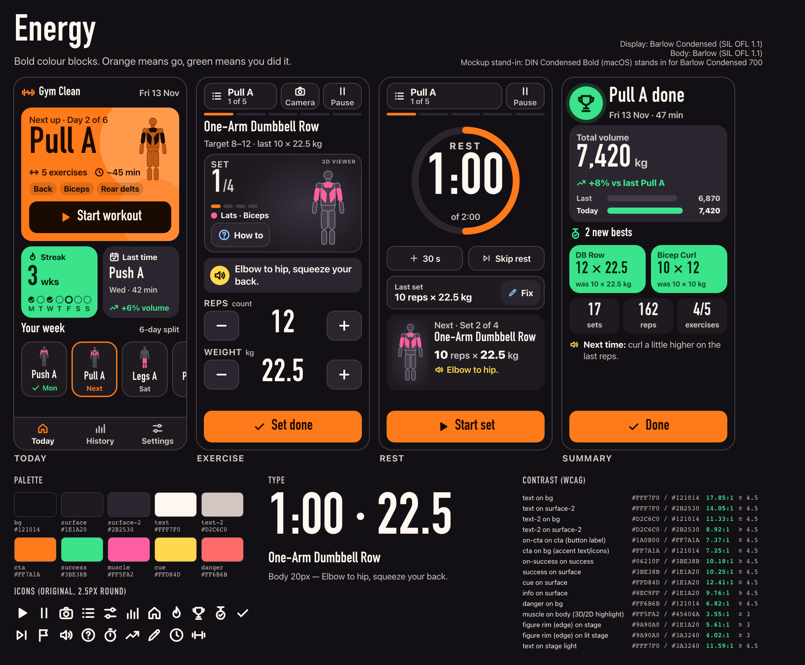
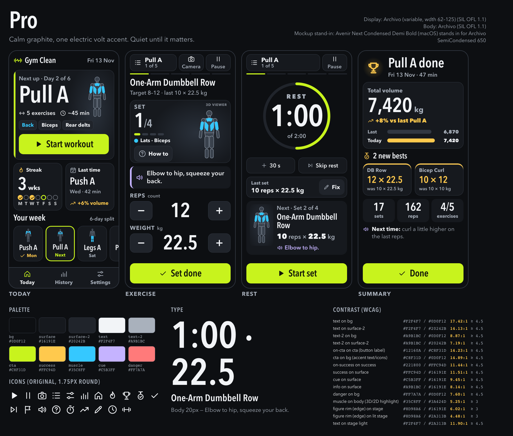
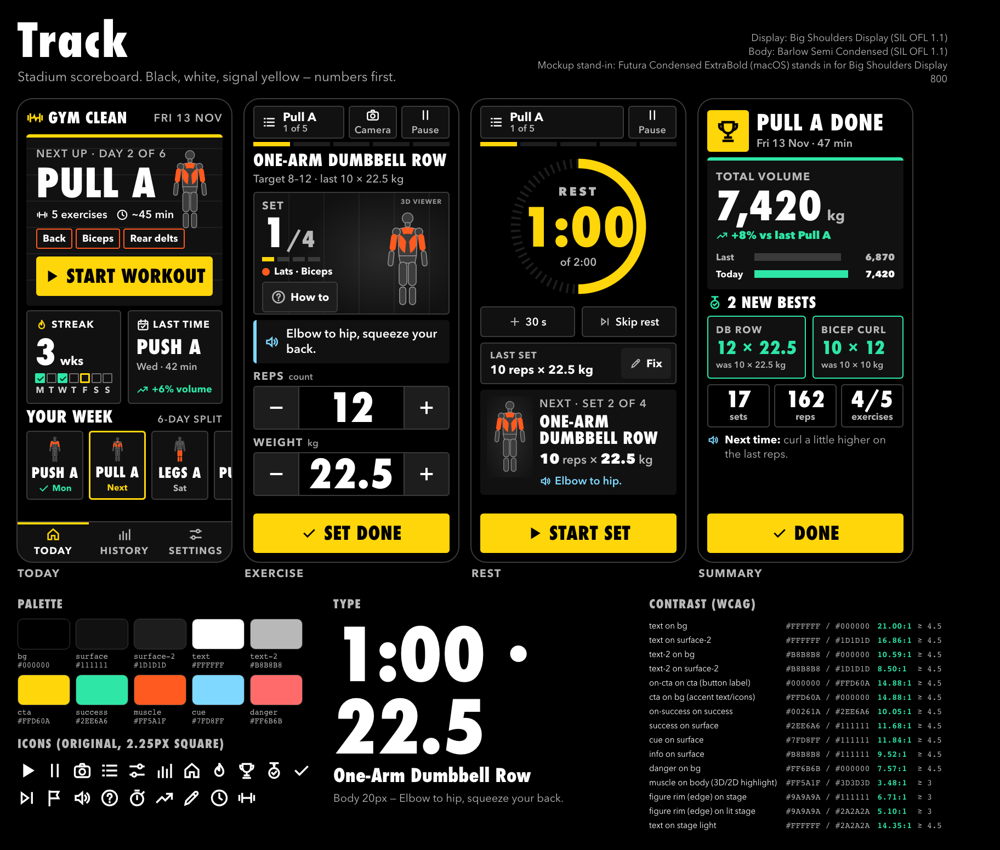

# M4e step 1 — three design directions

Mockups only. No app code changed. Wongsaton picks one (or mixes them) after the gym session.

Each direction has the same four screens at 390×844: **Today**, **Exercise**, **Rest**, **Summary**.
They use the same data (Pull A, One-Arm Dumbbell Row) so you only compare the look.

| | Energy | Pro | Track |
|---|---|---|---|
| Comparison sheet | [energy-sheet.png](energy-sheet.png) | [pro-sheet.png](pro-sheet.png) | [track-sheet.png](track-sheet.png) |
| Live mockup (open in a browser) | [energy.html](energy.html) | [pro.html](pro.html) | [track.html](track.html) |
| Screens | `energy-{today,exercise,rest,summary}.png` | `pro-…png` | `track-…png` |

Rebuild: `node docs/design/m4e-directions/_src/build.mjs && node docs/design/m4e-directions/_src/shoot.mjs`
(`build.mjs` writes the HTML and checks every colour pair; `shoot.mjs` takes the screenshots and flags
overflow, text under 16px and tap targets under 56px — the final run reported none.) Each HTML file stands
alone: CSS and SVG are inline and it makes no network requests. `shoot.mjs` logs any request that isn't a
`file:` or `data:` URL, and it logged none.

---

## What all three fix (from the UX audit)

| Audit issue | Fix used in every direction |
|---|---|
| 1. Today is six identical text cards | A **hero** card for the next workout (day name at 72–84px, exercise count, time, muscle chips, figure with the trained muscles lit) and a big **Start workout** button. Below it: a **streak** tile (weeks plus a Mon–Sun row) and a **last time** tile (day, length, volume trend). The six days become a **visual strip** with a small body figure per day; the next day is outlined. |
| 2. No visual language, ≡ typed as a character | One **original SVG icon set**, 25 icons on a 24px grid, drawn for this project (`ICONS` in `_src/build.mjs`). Every icon button also has a **text label**. Each direction draws the same set in its own style: Energy uses 2.5px strokes with round caps, Pro 1.75px round, Track 2.25px with square caps and mitred corners. |
| 3. Green does too many jobs | **Separate colour roles** (table per direction below): *action* (CTA, current progress), *success* (done, streak, bests, volume up), *muscle* (anatomy highlight only), *cue* (spoken coaching hint), *info* (how-to, fix). No colour has two jobs. |
| 4. System font only; italic cues hard to read | A **condensed display face** for numbers and titles plus a wide-aperture body face, both OFL and self-hosted. **No italics anywhere.** Cues are 22px semibold in a panel with a speaker icon, which also shows that the line is spoken. |
| 5. Small grey 3D figure lost on black; "Reps" touching − | The figure sits on a **lit stage**: a radial "spotlight" panel. It has a **rim colour** (the `--edge` token, at least 4:1 against the stage). Muscles use a separate hue that is at least 3:1 against the body. Set count, muscle legend and **How to** are grouped in the stage. **REPS / WEIGHT labels sit on their own line above** each stepper, so a label can't touch a button. |
| 6. Rest top bar crowded | The Rest top bar keeps only **workout/list** and **Pause** (Camera only matters during a set). A big **ring timer**, then **+30 s** and **Skip rest**, a **Last set … Fix** strip, a **Next** card with figure, target and cue, and **Start set**. |
| 7. Summary mostly empty, one negative stat | It opens with a celebration: trophy, "Pull A done". **Total volume** (72px) shows a **+8% vs last Pull A** bar comparison. A **"2 new bests"** section shows the old value under each new one. Sets, reps and exercises are tiles. The single improvement point is one positive **"Next time:"** line, placed last and kept low-key. |

### Proposed flow changes (need a yes from Wongsaton/main session before M4e step 3)
- **Skip exercise / End workout** leave the Exercise and Rest screens. They move to the **Pause** sheet and the
  workout list. This frees about 70px and removes a destructive button next to *Set done*. Ending the workout keeps its confirmation.
- **Rest gets +30 s and Skip rest** buttons. If `+30 s` isn't in the session reducer yet, core-engineer has to add it.
- Data the new screens need, as **pure selectors (core-engineer)**:
  - `weeklyStreak(history)`. Product call: a week counts if it has at least N workouts, and N must be decided.
  - `weekDots(history, today)`.
  - `lastSession(history)`.
  - `sessionVolume(session)`.
  - `volumeVsLast(session, history)`, which compares against the last session of the same day.
  - `newBests(session, history)`. A best is more reps at the same or higher weight, or more weight.
  - `nextTimeHint(session)`. It picks the most frequent partial reason from M4c's existing hints.

---

## Direction 1 — Energy
*"Bold colour blocks. Orange means go, green means you did it."* Warm charcoal background, solid colour tiles,
rounded shapes (24px cards). It's the loudest of the three and is built to make him want to start.

| Token | Hex | Role |
|---|---|---|
| `--bg` | `#121014` | page |
| `--surface` / `--surface-2` | `#1E1A20` / `#2B2530` | cards / buttons |
| `--line` | `#433A48` | borders, inactive progress |
| `--text` / `--text-2` | `#FFF7F0` / `#D2C6C0` | primary / secondary text |
| `--cta` / `--on-cta` | `#FF7A1A` / `#1A0B00` | **action**: Start, Set done, current segment, ring |
| `--success` / `--on-success` | `#3BE38B` / `#06210F` | **success**: streak block, bests, volume up, done days |
| `--muscle` | `#FF5FA2` | **muscle highlight only** |
| `--cue` | `#FFD84D` | **spoken cue** marker |
| `--info` | `#8EC9FF` | how-to, fix |
| `--danger` | `#FF6B6B` | end/delete confirmations only |
| `--body` / `--edge` / `--stage-1` | `#45404A` / `#9A90A0` / `#3A3240` | figure fill / rim / stage light |

Contrast checked by `build.mjs` (all pass):
- **Text pairs (need ≥ 4.5:1):** text on bg 17.85, text-2 on bg 11.33, text-2 on surface-2 8.92, on-cta on cta 7.37,
  cta on bg 7.25, on-success on success 10.18, success on surface 10.25, cue on surface 12.41, info on surface 9.76, danger on bg 6.82.
- **Graphics (need ≥ 3:1):** muscle on body 3.55, rim on stage 5.61, rim on lit stage 4.02.

- **Type:** Barlow Condensed 700 for display and numbers, Barlow 400–700 for body. Both are SIL OFL 1.1.
  Scale: body 20, cue 22, title 34, hero 84, numbers 72, timer 132 (px).
- **Icons:** 2.5px stroke, round caps. The Today icon in the tab bar turns orange; the cue icon sits in a yellow disc.
- **Motion:** the hero's background circles drift slowly (6 s). When a rep or set is logged, the number gives a short
  80 ms "punch" (scale 1→1.06→1). New bests slide in on Summary. All of this sits behind `prefers-reduced-motion: no-preference`.
- **Pros:**
  - The strongest first impression.
  - The colour blocks read from across the room. Orange = go, green = done is easy to learn.
  - Warm and personal.
- **Cons:**
  - It uses five hues, so it can tip into a rainbow as more screens are added.
  - Full orange hero and green tiles are bright on a dark gym floor between sets.
  - The pink muscle colour sits close to the danger red. Danger is kept to confirmation dialogs to compensate.

## Direction 2 — Pro
*"Calm graphite, one electric volt accent. Quiet until it matters."* Graphite surfaces with hairline borders.
A single volt colour marks what to press and where you are now. Other colours appear only where they carry meaning.

| Token | Hex | Role |
|---|---|---|
| `--bg` | `#0D0F12` | page |
| `--surface` / `--surface-2` | `#16191E` / `#20242B` | cards / buttons |
| `--line` | `#323842` | 1px hairlines |
| `--text` / `--text-2` | `#F2F4F7` / `#A9B1BC` | primary / secondary text |
| `--cta` / `--on-cta` | `#C8F31D` / `#12160A` | **action + now**: buttons, current segment, ring, today's dot |
| `--success` / `--on-success` | `#FFC94D` / `#221800` | **success**: bests, volume up, done days (gold = medal) |
| `--muscle` | `#35C8FF` | **muscle highlight only** |
| `--cue` | `#C5B3FF` | **spoken cue** bar + icon |
| `--info` | `#A9B1BC` | how-to, fix (stays neutral) |
| `--danger` | `#FF7A7A` | confirmations only |
| `--body` / `--edge` / `--stage-1` | `#3A424D` / `#8D98A6` / `#2A313B` | figure fill / rim / stage light |

Contrast checked by `build.mjs` (all pass):
- **Text pairs (need ≥ 4.5:1):** text on bg 17.42, text-2 on bg 8.87, text-2 on surface-2 7.19, on-cta on cta 14.23,
  cta on bg 14.89, on-success on success 11.44, success on surface 11.51, cue on surface 9.45, danger on bg 7.60.
- **Graphics (need ≥ 3:1):** muscle on body 5.25, rim on stage 6.02, rim on lit stage 4.48.

- **Type:** Archivo, a variable font with a width axis (62–125) and weight 100–900, SIL OFL 1.1. One family covers both
  uses: SemiCondensed at weight 600–650 for display and numbers, Normal width at weight 400–700 for body. That means one
  font file. Scale: body 20, cue 22, title 34, hero 84, numbers 72, timer 108 (px).
- **Icons:** 1.75px stroke, round caps. These are the lightest of the three, but they sit at 26–30px, so they stay readable.
- **Motion:** the ring drains smoothly, updated every second with a linear transition. The CTA has a 150 ms press
  scale. On Summary the volume bars fill in 400 ms. No looping animation. All of this sits behind `prefers-reduced-motion`.
- **Pros:**
  - The calmest screens while working out: only one thing glows, the button to press.
  - Volt on graphite has the highest CTA contrast of the three (14:1).
  - The colour roles are the clearest: the CTA colour is used nowhere else, and info stays grey.
  - Ages well as screens are added.
  - One font family means the smallest font download.
- **Cons:**
  - The first impression is less loud than Energy's. The hero motivates through the lit figure and the big name,
    not a block of colour.
  - Volt is a fashionable choice: it might feel familiar from sportswear.
  - The 1px hairlines vanish at 2 m. That's fine because nothing important relies on them.

## Direction 3 — Track
*"Stadium scoreboard. Black, white, signal yellow — numbers first."* Pure black, ruled "lane" lines, square corners
(6px), headings in condensed caps, segmented stepper boxes like a scoreboard, and a dashed ring that drains in yellow.

| Token | Hex | Role |
|---|---|---|
| `--bg` | `#000000` | page (OLED-black) |
| `--surface` / `--surface-2` | `#111111` / `#1D1D1D` | cards / buttons |
| `--line` | `#3A3A3A` | 2px rules |
| `--text` / `--text-2` | `#FFFFFF` / `#B8B8B8` | primary / secondary text |
| `--cta` / `--on-cta` | `#FFD60A` / `#000000` | **action + live**: buttons, countdown digits, current segment |
| `--success` / `--on-success` | `#2EE6A6` / `#00261A` | **success**: bests, volume up, done days |
| `--muscle` | `#FF5A1F` | **muscle highlight only** (track-tartan orange) |
| `--cue` | `#7FD8FF` | **spoken cue** bar + icon |
| `--info` | `#B8B8B8` | how-to, fix |
| `--danger` | `#FF6B6B` | confirmations only |
| `--body` / `--edge` / `--stage-1` | `#3D3D3D` / `#9A9A9A` / `#2A2A2A` | figure fill / rim / stage light |

Contrast checked by `build.mjs` (all pass):
- **Text pairs (need ≥ 4.5:1):** text on bg 21.0, text-2 on bg 10.59, text-2 on surface-2 8.50, on-cta on cta 14.88,
  cta on bg 14.88, on-success on success 10.05, success on surface 11.68, cue on surface 11.84, danger on bg 7.57.
- **Graphics (need ≥ 3:1):** muscle on body 3.48, rim on stage 6.71, rim on lit stage 5.10.

- **Type:** Big Shoulders Display 800 for display and numbers, Barlow Semi Condensed 400–700 for body. Both are SIL OFL 1.1.
  Big Shoulders is much narrower than the macOS stand-in, so in the real build the timer goes back up to 132px and
  "PULL A" to 84px. The mockup had to use 96px and 72px to fit the wider stand-in.
- **Icons:** 2.25px stroke with square caps and mitred corners, to match the hard edges.
- **Motion:** the countdown digits flip like a scoreboard (a 120 ms vertical slide per digit change), the ring ticks in
  1-second steps, and the active tab has a yellow bar. All of this sits behind `prefers-reduced-motion`.
- **Pros:**
  - The most readable at 2 m: pure black and white, 21:1 text, a huge yellow countdown.
  - The most "sport", and the most distinctive.
  - OLED black saves battery during long sessions.
- **Cons:**
  - Uppercase condensed headings get tiring to read on long exercise names. The mockup already wraps
    "One-Arm Dumbbell Row" on Rest.
  - It feels the most intense, and the least "clean" in Wongsaton's own words.
  - Yellow does two jobs, action and live countdown. That's acceptable because both mean "now", but it's less pure than Pro.

---

## How each meets the 2 m rules (all three)
- **Main numbers ≥ 64px:**
  - The steppers are 72px. The condensed faces fit "22.5" between the buttons, so the 54px stepper exception isn't needed.
  - Set count 72px, volume 72px, streak 64px.
  - Timer: 132px (Energy), 108px (Pro), 96px in the Track mockup, which becomes 132px with the real font.
  - Day name in the hero 72–84px.
- **Body ≥ 20px:**
  - All reading text and button labels are 20–34px. The cue is 22px semibold, never italic.
  - **One bend:** short labels that sit next to an icon or picture are 16–18px. These are the tab and top-bar icon
    labels (18), the M–S week letters (16), "was 10 × 22.5 kg" under a best (16), and the stepper unit (17). The icon
    or number carries the meaning, and nothing there has to be read mid-set.
  - The "3D viewer" tag (12px) only labels the placeholder in the mockup; it won't ship.
- **Tap targets ≥ 56px:**
  - `shoot.mjs` measures every button and found none under 56px.
  - Top bar 60px, steppers 68–76px, CTA 72px, tabs 72px, ghost buttons 56px, day cards 104×126.
- **High contrast and dark by default:** see the tables. Every text pair is ≥ 4.5:1 (the lowest is 6.82:1), and every
  graphic pair is ≥ 3:1. Colour never carries meaning on its own: muscles also get a text legend, done days a ✓
  icon, the cue a speaker icon.
- **No horizontal overflow:** each screen is exactly 390px wide. The day strip scrolls inside its own row, cut off on
  purpose at the right edge as an affordance. The page itself never scrolls sideways.
- **Voice over screen:** unchanged. The cue panel's speaker icon shows that the line is spoken. The Summary "Next time"
  line can be spoken once when the workout ends.
- **Reduced motion:** every animation idea sits inside `@media (prefers-reduced-motion: no-preference)`. Without motion,
  values update instantly.

## Fonts — how they will be self-hosted (no third-party requests)
The mockups use macOS system fonts loaded through `local()` as stand-ins (no font files are in `node_modules` yet):
- DIN Condensed Bold stands in for Barlow Condensed (Energy).
- Avenir Next Condensed Demi Bold stands in for Archivo (Pro).
- Futura Condensed ExtraBold stands in for Big Shoulders Display (Track).

For the real build, the main session adds **one** of these npm packages to `package.json`, all OFL-licensed:
`@fontsource/barlow-condensed` + `@fontsource/barlow`, `@fontsource-variable/archivo`, or
`@fontsource/big-shoulders-display` + `@fontsource/barlow-semi-condensed`. Then either:
1. import only the latin-subset CSS for the needed weights in `src/main.ts`. Vite bundles the `.woff2` files into
   `dist/assets`, so they are same-origin and fine under the CSP. Or
2. copy those `.woff2` files to `public/fonts/` and declare them in `src/styles.css` with
   `@font-face { font-family:'GC Display'; src:url('/fonts/…woff2') format('woff2'); font-display:swap; }`,
   then add `<link rel="preload" as="font" crossorigin>` for the display weight.

For Pro, check that the variable package includes the **width axis**. If not, use the static Archivo SemiCondensed
files from the Archivo repository (also OFL). Keep the total font download small: one display weight plus 2–3 body
weights, latin subset only. The PWA (M6) precaches them so they work offline.

## Recommendation
**Pro as the base system, with Energy's orange offered as an accent theme in Settings** (M4e step 2 already plans
accent themes, so this only means swapping `--cta`).
- **During a set**, the screen should be calm, with one thing that glows: the button to press. Pro does this best.
  Its colour roles are the cleanest answer to audit item 3: action, success, muscle and cue each get their own hue,
  and info stays grey.
- **It scales:** Pro will hold up as Settings, the camera screen, History and nutrition (M7) are added. Energy's
  colour blocks tend to multiply, and Track's caps get tiring on long text.
- **One font family** (Archivo) is the smallest self-hosted download.
- **Runner-up:** if the first impression matters most to Wongsaton, pick **Energy**. Its orange hero is the strongest
  "go train" signal of the three.
- **Track** is the most readable but also the most intense. It would make a good "high contrast" theme later.

This is a taste call. The hard rules hold in all three directions, so any choice is safe.
