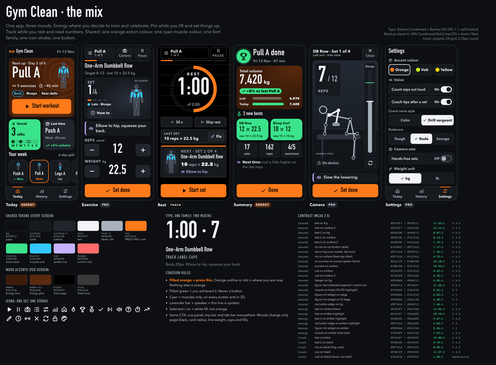

# M4e step 1b: the mix (Energy + Pro + Track)

Mockups only. No app code changed. This follows Wongsaton's answer to the step-1 pick: *"Mix all of them together, some
screens need Energy, some Pro and some Track."* Step 1 (the three separate directions) is in
[`../m4e-directions/`](../m4e-directions/README.md).

| File | What |
|---|---|
| [mix-sheet.png](mix-sheet.png) | Comparison sheet: the six screens side by side, shared tokens, mood accents, type, icons, cohesion rules, contrast table |
| [mix.html](mix.html) | Live mockup, open in a browser (self-contained: inline CSS and SVG, no network) |
| `today.png`, `exercise.png`, `rest.png`, `summary.png`, `camera.png`, `settings.png` | The screens at 390×844 (2× pixels) |
| `_src/build.mjs` | Writes `mix.html`, `_src/mix-sheet.html` and `_src/contrast.json`, and checks every colour pair |
| `_src/shoot.mjs` | Takes the screenshots and flags overflow, text under 16px, tap targets under 56px and any non-`file:`/`data:` request |

Rebuild: `node docs/design/m4e-mix/_src/build.mjs && node docs/design/m4e-mix/_src/shoot.mjs`.
The final run reported **all 29 colour pairs pass, 0 layout issues and 0 external requests**.

---

## Per-screen mapping

| Screen | Mood | Why |
|---|---|---|
| **Today** | Energy | This is the first impression and the "go train" moment. It uses a warm ember hero with orange rings, an 84px day name, a big orange **Start workout** button and a solid green streak block. |
| **Exercise** | Pro | You see this mid-set. It stays calm graphite with one orange thing, **Set done**. Cyan muscles sit on the stage and the lavender cue bar shows the spoken line. |
| **Camera** | Pro | The camera image is busy enough already. The HUD is a solid panel (not translucent, so contrast is guaranteed) with a 120px rep count and a neutral range gauge with a green target mark. **Set done** is the only orange. |
| **Rest** | Track | Rest is about reading a number from across the room. The page is OLED black with ruled lanes and caps labels. There's a 132px white countdown with a dashed ring that drains in orange, then **Start set**. |
| **Summary** | Energy | The celebration: a green trophy burst, a volume card on the ember surface, solid green **new best** blocks, then a low-key "Next time" line. |
| **Settings** | Pro | An admin screen. It's calm, and selected/on states use white fill so nothing competes with the action colour. It also shows the **accent colour** choice planned for step 2. |
| History / stats (later) | Track | Numbers and tables, built like a scoreboard. Not mocked yet because the screen doesn't exist. |
| Pause sheet, exercise list, How-to sheet | Pro | These are overlays on a Pro or Track screen, so they stay neutral. |

**Refinements to the main-session proposal** (ui-ux-pro-max: `consistency`, `icon-style-consistent`,
`primary-action`, `color-semantic`, `navigation-consistency`, "Stroke Consistency" in pro-rules):
1. **One action colour app-wide (orange), not per screen.**
   - Exercise → Rest → Exercise repeats every set. If "press this" went orange → yellow → volt across those screens, the hand would have to re-learn it every 90 s.
   - So orange is the single action colour, and each mood is carried by everything *except* the button colour.
   - Orange comes from Energy because Energy is the mood of the first impression.
   - Pro's rule (one glowing thing) and Track's rule (a bright "now" colour on black) both work with any single accent, so neither loses its identity.
2. **Energy's colour blocks are green (achievement) or ember (mood), never orange.**
   - In step 1, the Energy hero was a solid orange block with a dark button on it. That broke "orange = press this".
   - Now the hero is a dark ember surface with orange rings as decoration, and the orange fill is the button itself.
3. **Track keeps its black, lanes, caps and segmented ring, but its yellow becomes the shared orange.**
   - The countdown digits are white, not yellow (19:1 on black, more than yellow's 15:1).
   - Caps are used only for short labels (REST, LAST SET, NEXT · SET 2 OF 4). Exercise names stay in mixed case, which fixes the step-1 complaint that long caps names are tiring.
4. **One muscle colour everywhere: Pro's cyan.**
   - Energy's pink sat close to danger red.
   - Track's orange would now clash with the action colour.
   - Cyan is the only one of the three that is far from orange, green and lavender.
5. **One cue colour: Pro's lavender.** Energy's yellow and Track's light blue sat too close to orange and cyan respectively.

---

## Shared foundation (identical on every screen)

### Colour roles (shared tokens)

| Token | Hex | Role, and the only role |
|---|---|---|
| `--bg` | `#0D0F12` | page (Track screens override to `#000000`) |
| `--surface` / `--surface-2` | `#16191E` / `#20242B` | cards / buttons |
| `--line` | `#323842` | borders, inactive progress |
| `--text` / `--text-2` | `#F2F4F7` / `#A9B1BC` | primary / secondary text; `--info` = `--text-2` |
| `--cta` / `--on-cta` | `#FF7A1A` / `#1A0B00` | **action.** A **filled** orange shape is something to press. An orange **outline, dot, bar or ring** marks where you are now (current segment, current set pip, active tab, next day, rest ring). Nothing else is orange. |
| `--success` / `--on-success` | `#3BE38B` / `#06210F` | **achieved:** streak, done days, new bests, volume up, range target. A filled green shape is never a button. |
| `--muscle` | `#35C8FF` | **muscle highlight only**, in 2D, 3D and the hero chip. Always paired with a text legend. |
| `--body` / `--edge` / `--stage-1` / `--stage-2` | `#3A424D` / `#8D98A6` / `#2A313B` / `#16191E` | figure fill / rim / lit stage / stage |
| `--cue` | `#C5B3FF` | **spoken** line: a lavender left bar plus a speaker icon |
| `--danger` | `#FF6B6B` | confirmations only (End workout), always with an icon and words |

**Selected/on states** (segmented controls, switches, the chosen accent) use a **white fill with dark text**. They are
not orange, because a setting that is already chosen isn't "press this".

### Type: one family, two widths
- **Barlow Condensed** for display and numbers: 700, plus 800 for Track caps labels if wanted.
- **Barlow** for body text: 400, 600 and 700.
- Both are SIL OFL 1.1, by the same designer and the same superfamily, so they match.
- ui-ux-pro-max's "Sports/Fitness" pairing is exactly this pair.
- The mockup uses stand-ins: DIN Condensed Bold (macOS, loaded through `local()`) for Barlow Condensed, and Avenir Next for Barlow.
- **Self-hosting in the app:** add `@fontsource/barlow-condensed` and `@fontsource/barlow` (main session, `package.json`), and import only the latin-subset CSS for the listed weights. Vite bundles the `.woff2` files same-origin, which is fine under the CSP. The PWA precaches them.
- Scale (px): label 18, body 20, cue 22, title 34, numbers 72, hero 84, rep count 120, timer 132. No italics.
- Track's identity comes from **uppercase + 0.08em tracking** on short labels, not from a third font. Step 1's Big Shoulders is dropped.

### Icons: one geometry, one stroke
- The same original 24-grid set as step 1 (`ICONS` in `_src/build.mjs`), plus `close`, `flip`, `lock`, `palette` and `ruler`.
- **2.25px stroke and round caps on every screen.** This is the middle of step 1's 1.75 (Pro) and 2.5 (Energy). It reads at 2 m and isn't heavy.
- ui-ux-pro-max "Stroke Consistency" argues against mixing weights per screen, and Track's square caps would look like a different icon set next to the round ones.
- Size tokens are `--ic-sm` 22, `--ic-md` 28 and `--ic-lg` 32. Stepper +/− use 3px at 32px.
- Every icon button has a text label.

### Components that never change between moods (the cohesion anchors)
- **CTA:** 72px tall (80 in the Today hero), full width, `--r-btn` 14px, orange, Barlow Condensed 34px, always at the bottom of the screen.
- **Cue panel:** surface, 6px lavender left bar, speaker icon, 22px semibold.
- **Workout top bar:** list / Camera / Pause on Exercise; list / Pause on Rest. 60px tall, with the same orange current-segment bar.
- **Tab bar:** Today / History / Settings, 72px, with an orange icon and an orange top bar on the active tab.
- **Figure:** the same body, rim and cyan muscle colours on Today, Exercise, Rest and in the 3D viewer.

## Per-screen mood accents (the only things that differ)

| Mood | Tokens it sets | Card radius | Line weight | Other traits |
|---|---|---|---|---|
| **Energy** (Today, Summary) | `--ember #3D1C0A`, `--ember-hi #5A2A0E` | 24px | 2px | ember radial hero and volume card, orange decorative rings (35% opacity, no meaning), solid **green** blocks for streak and bests, trophy burst |
| **Pro** (Exercise, Camera, Settings) | none, it's the default | 20px | 1px | graphite, hairlines, lit stage behind the figure, solid HUD panels on the camera |
| **Track** (Rest, History) | `--bg #000000`, `--line #3A3A3A` | 8px | 2px | ruled lanes behind the timer, dashed ring track with a butt-capped orange drain, caps labels, an orange top rule on the Next card |

Moving from Exercise (Pro, graphite) to Rest (Track, black) changes the page black, the corners and the labels. That's the
visible "you're resting now" signal. The top bar, CTA, cue panel and colours stay put.

## Contrast (checked by `build.mjs`, all pass)

Text needs ≥ 4.5:1, graphics and figure needs ≥ 3:1.

**Shared:**

| Pair | Ratio |
|---|---|
| text on bg | 17.42 |
| text on surface-2 | 14.13 |
| text-2 on bg | 8.87 |
| text-2 on surface | 8.14 |
| text-2 on surface-2 | 7.19 |
| on-cta on cta | 7.37 |
| cta on bg | 7.36 |
| cta on surface | 6.75 |
| on-success on success | 10.18 |
| success on surface | 10.53 |
| cue on surface | 9.45 |
| cue on surface-2 | 8.35 |
| danger on bg | 6.92 |
| bg on text (selected) | 17.42 |
| muscle on body | 5.25 |
| rim on stage | 6.02 |
| rim on lit stage | 4.48 |

**Energy accents:**

| Pair | Ratio |
|---|---|
| text on ember | 13.92 |
| text on ember-hi | 10.75 |
| text-2 on ember-hi | 5.47 |
| CTA edge on ember-hi | 4.54 |
| rim on ember | 5.24 |
| muscle chip text on ember | 7.93 |

**Track accents:**

| Pair | Ratio |
|---|---|
| text on black | 19.06 |
| text-2 on black | 9.70 |
| cta on black | 8.05 |
| cue on black | 11.27 |

The Track lane rules (1.85:1) are decorative only and carry no information.

Full table: `_src/contrast.json` and the sheet.

## Gym rules check
- **Numbers ≥ 64px:**
  - steppers 72
  - set count 72
  - rep count 120
  - timer 132
  - volume 72
  - streak 64
  - hero day name 84
  - No 54px stepper exception needed.
- **Text ≥ 20px:** all reading text and button labels are 20–34px. The same bend as step 1 applies to short labels next to an icon or number, which are 16–18px:
  - tab and top-bar labels
  - M–S week letters
  - "was 10 × 22.5 kg"
  - unit labels
  - the camera "Range" gauge label and the "On device" chip
  - Settings sub-labels "Coach voice style" / "Rudeness" (18px, above 56px controls that carry their own 20px text)

  `shoot.mjs` found no text under 16px. The 12px "3D viewer" / "camera feed" tags only label placeholders and won't ship.
- **Tap targets ≥ 56px:** `shoot.mjs` measured every button and tab and found none under 56px.
  - top bar 60
  - CTA 72/80
  - stepper buttons 68
  - Settings rows 60
  - segments 56
  - switch-camera 60
  - tabs 72
- **Dark theme and high contrast:** see above. Colour never carries meaning alone (legend text, ✓ icons, speaker icon, On/Off words next to switches).
- **No horizontal overflow:** every screen is 390px wide. The day strip scrolls inside its own row on purpose.
- **Voice over screen:** unchanged. The lavender cue panel marks spoken lines, and the camera cue ("Slow the lowering.") is M5's spoken cue.
- **Reduced motion:** the hero ring pulse, ring drain, CTA press and rep punch all sit inside `@media (prefers-reduced-motion: no-preference)`.
- **Original art:** the figure, skeleton, bench and icons are drawn here. No external images, no network requests.

## Notes for step 2 (tokens + themes)
- The Settings mock shows **Orange / Volt / Yellow** accent themes. A theme only swaps `--cta`/`--on-cta`. Muscle (cyan), success (green) and cue (lavender) stay fixed.
  - **Volt sits fairly close to the success green.** If Volt is offered, keep the rule "filled green is never a button, and bests carry a medal icon". Alternatively, change success to Pro's gold `#FFC94D` while Volt is active. Product call for Wongsaton.
  - Yellow vs orange: either works. On-cta must stay dark on both (≥ 7:1).
- `styles.css` gets the shared tokens on `:root` and three mood classes (`.mood-energy`, `.mood-pro`, `.mood-track`) on each screen root. Screens never use raw hex.
- The camera HUD panels must stay solid `--surface`, not translucent, because the video behind them is unpredictable.
- Pure data the new screens need, as listed in step 1 (`weeklyStreak`, `weekDots`, `lastSession`, `sessionVolume`, `volumeVsLast`, `newBests`, `nextTimeHint`). These are core-engineer selectors, not UI.
- The Rest **+30 s** button and moving Skip/End into the Pause sheet are still the step-1 flow proposals awaiting a yes.
